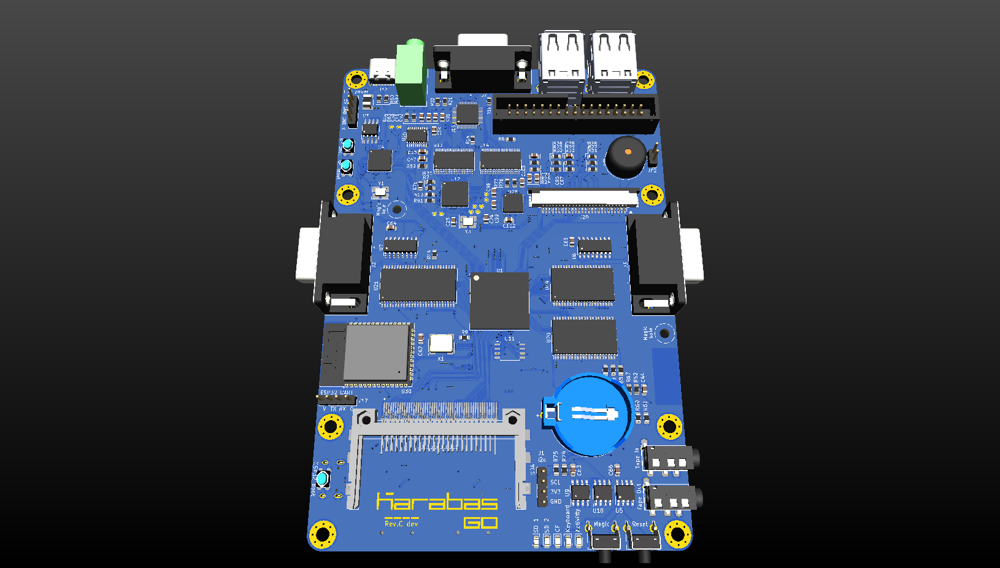
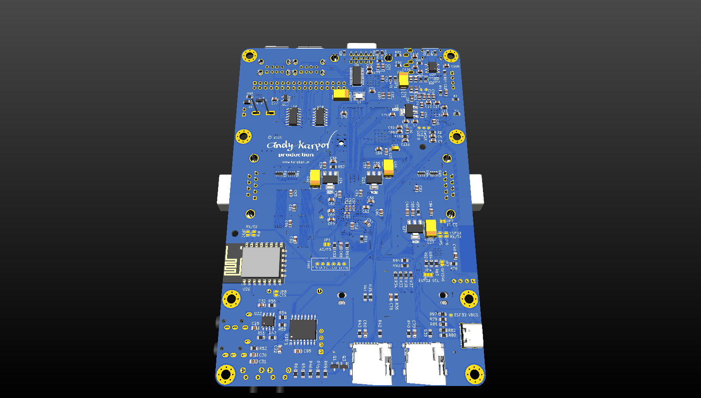
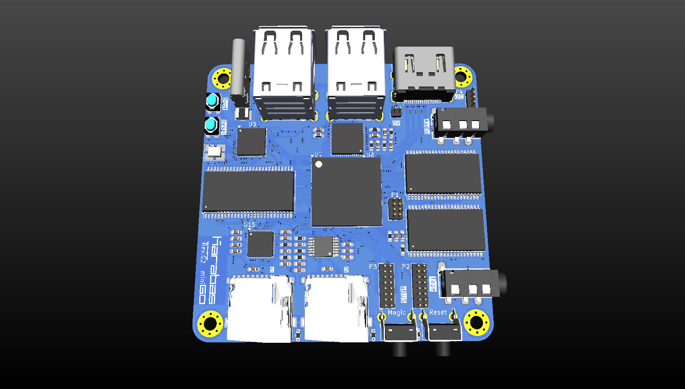
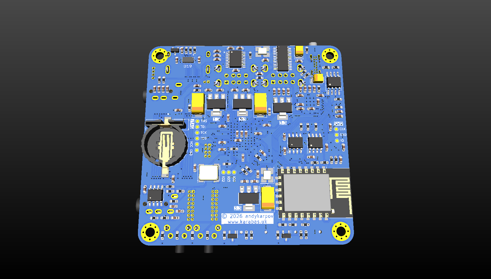
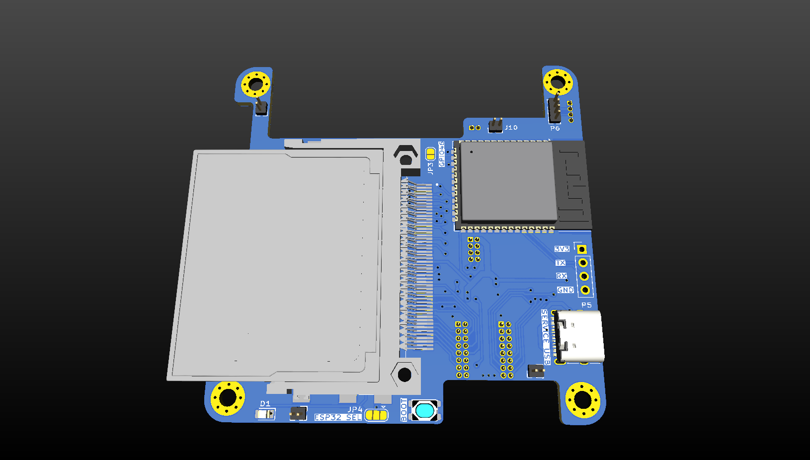
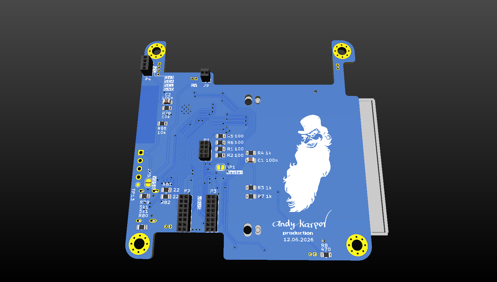
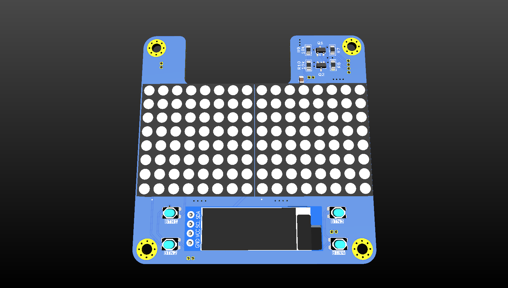
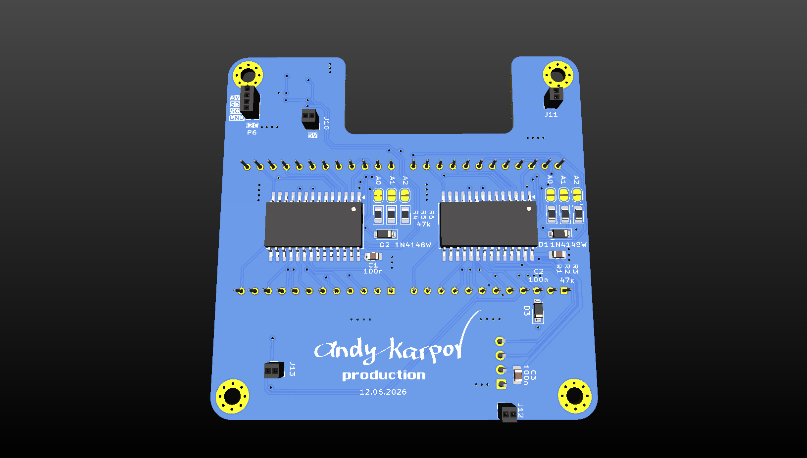

# Karabas Go, Mini, Mini G

English | [Русский](README.ru.md)

Spartan-6 based devboards to emulate different retro-computers: Karabas Go and Karabas Mini /
Mini G. This repository has what goes onto the SD card and the boards (the cores, the
firmware), the hardware documents (schematics, BOMs, gerbers) and the 3D enclosures of all of
them. (The Mini used to have its own repository, [karabas-mini](https://github.com/andykarpov/karabas-mini), archived now.)

The hardware design and documentation are licensed under [Creative Commons Attribution-NonCommercial-ShareAlike 4.0 International](http://creativecommons.org/licenses/by-nc-sa/4.0/).

FPGA cores, the firmware and other software parts are licensed by their own licenses.

## Getting started

[docs/howto.md](docs/howto.md): the cores of `cores/` to the root of SD card #1 (one `.kg` file
per core for every board), the firmware of the board from `firmware/`:

| Board | Firmware |
| --- | --- |
| Karabas Go | `firmware/karabas_go.uf2` |
| Karabas Mini, rev.C .. rev.F3 | `firmware/karabas_mini.uf2` |
| Karabas Mini G, rev.G / G2 | `firmware/karabas_minig.uf2` |

The `.kg` cores need the firmware 26110415 or later; an older firmware stops with "Boot file not
found".

[Karabas Flasher](https://github.com/xdemax/kgff) (kgff, by xdemax, MIT; Windows, Linux, macOS)
does it in one window: it downloads the firmware and the cores of this repository, flashes the
RP2040 firmware, replaces the `.kg` cores on SD card #1 (the old ones go to a backup folder),
copies extra content (ROMs, disk images) and finds the board model by `AT+KARABAS=version`.
Core updates need the firmware of 2026-10-18 or later: if unsure, update the firmware alone first.

## Layout

| Path | What |
| --- | --- |
| `cores/` | the cores, `*.kg` (one file for all the boards) |
| `firmware/` | the RP2040 firmware of each board; `esp32-s3/` the ESP32-S3 of the Mini G shield |
| `software/` | extra files for the cores (`TBBLUE.FW` of ZX Next, plugins) |
| `docs/go/`, `docs/mini/` | schematics (PDF), interactive BOMs, renders; `docs/mini/revF_mod.md` the FT812 clock mod of Mini rev.C, D, F |
| `pcb/go/`, `pcb/mini/` | gerbers of each revision, `PCB_CHANGELOG.md` |
| `case/go/`, `case/mini/` | 3D enclosure models |

## The boards

### Karabas Go

- A 25k LE's Spartan-6 FPGA
- RP2040 MCU
- 4x USB Ports
- 2x 2MB 10ns SRAM chips
- 32MB SDRAM chip
- VGA 8:8:8 output
- On-board FT812 video processor
- 16-bit audio DAC
- SAM2695 midi synth
- 2x Sega/Atari compatible DB9 joystick ports
- CF card
- 2x microSD cards
- Tape In/Out interface
- FDD port
- Buzzer
- DS3221 RTC
- 1kB EEPROM
- ESP8266 Wi-Fi module

The latest PCB revision is Rev.B4 ([changelog](pcb/go/PCB_CHANGELOG.md)). Rev.B4 could be a bit
incompatible with the 3D enclosure models: its microSD cards are shifted a bit forward.
PCB sources: [karabas-go-pcb](https://github.com/andykarpov/karabas-go-pcb).

### Karabas Mini / Mini G

- A 25k LE's Spartan-6 FPGA
- RP2040 MCU
- 4x USB Ports
- 2x 2MB 10ns SRAM chips
- 32MB SDRAM chip
- DVI output
- On-board FT812 video processor
- SAM2695 midi synth
- 2x microSD cards
- Tape In/Out interface
- DS3221 RTC
- 1kB EEPROM
- ESP8266 Wi-Fi module
- uBUS expansion connector
- ESP32-S3 as VDAC32 mcu
- CF card

The latest stable PCB revision is Rev.G ([changelog](pcb/mini/PCB_CHANGELOG.md)). Rev.C, D and F
need a small [HW mod](docs/mini/revF_mod.md) for the cores that use the FT812.
PCB sources: [karabas-mini-pcb](https://github.com/andykarpov/karabas-mini-pcb).

Shield with CF card and ESP32-S3 for rev.G (2nd floor):

Shield for the v4 shield with a dot matrix display (3rd floor):

## Sources

FPGA cores:

- Boot Menu Core: https://github.com/andykarpov/karabas-go-core-menu
- Test Core: https://github.com/andykarpov/karabas-go-core-test
- TS-Conf Core: https://github.com/andykarpov/karabas-go-core-tsconf
- ZX Spectrum Next Core: https://github.com/andykarpov/karabas-go-core-next
- Karabas Pro Core: https://github.com/andykarpov/karabas-go-core-profi
- PCXT Core: https://github.com/andykarpov/karabas-go-core-pcxt
- NES Core: https://github.com/andykarpov/karabas-go-core-nes
- SNES Core: https://github.com/andykarpov/karabas-go-core-snes
- Sega Mega Drive / Genesis Core (Mini G for now): https://github.com/andykarpov/karabas-go-core-sega
- Radio-86RK family Core (RK86, Mikrosha, Apogey, Partner, Mikro-80): https://github.com/andykarpov/karabas-go-core-rk
- Alf Core: https://github.com/andykarpov/karabas-go-core-alf
- MSX1 Core: https://github.com/andykarpov/karabas-go-core-msx
- MSX2 / MSX2+ Core: https://github.com/andykarpov/karabas-go-core-msx2
- ZX Evolution BaseConf Core: https://github.com/andykarpov/karabas-go-core-baseconf
- UKNC (MC-0511) Core: https://github.com/andykarpov/karabas-go-core-uknc
- Orion-128 Core: https://github.com/andykarpov/karabas-go-core-orion128
- Orion-PRO Core: https://github.com/andykarpov/karabas-go-core-orionpro
- Specialist / Specialist-MX Core: https://github.com/andykarpov/karabas-go-core-specialist
- BK-0011M + AZBK Core: https://github.com/andykarpov/karabas-go-core-bk
- Atari ST / STE Core: https://github.com/andykarpov/karabas-go-core-atarist
- Sinclair QL Core: https://github.com/andykarpov/karabas-go-core-ql
- PDP-11/70: https://github.com/tsybulin/karabas-go-core-pdp2026
- Commodore VIC-20 Core: https://github.com/andykarpov/karabas-go-core-vic20
- Commodore 64 Core: https://github.com/xdemax/karabas-go-core-c64
- Apple Macintosh Plus Core: https://github.com/andykarpov/karabas-go-core-macplus
- Acorn Archimedes Core (RISC OS 3.11, needs your own ROM image): https://github.com/andykarpov/karabas-go-core-archie
- Apple //e Core: https://github.com/andykarpov/karabas-go-core-apple2
- Atari 2600 VCS Core: https://github.com/andykarpov/karabas-go-core-atari2600
- V6Z80P+ (OSCA) Core: https://github.com/Caasper911/karabas-go-core-v6z80p

The firmware: https://github.com/andykarpov/karabas-go-firmware

Dev tools (`make_core`): https://github.com/andykarpov/karabas-go-tools
