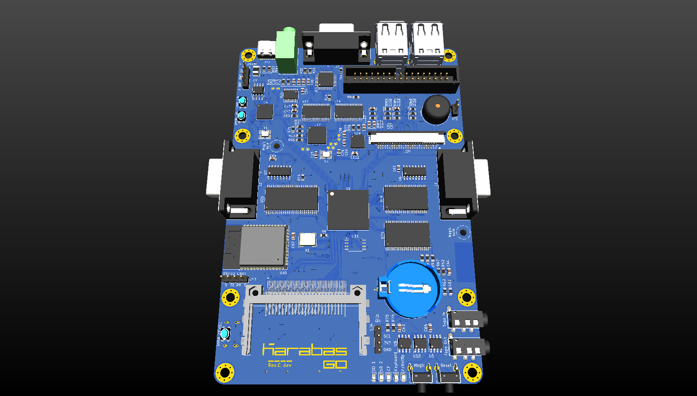
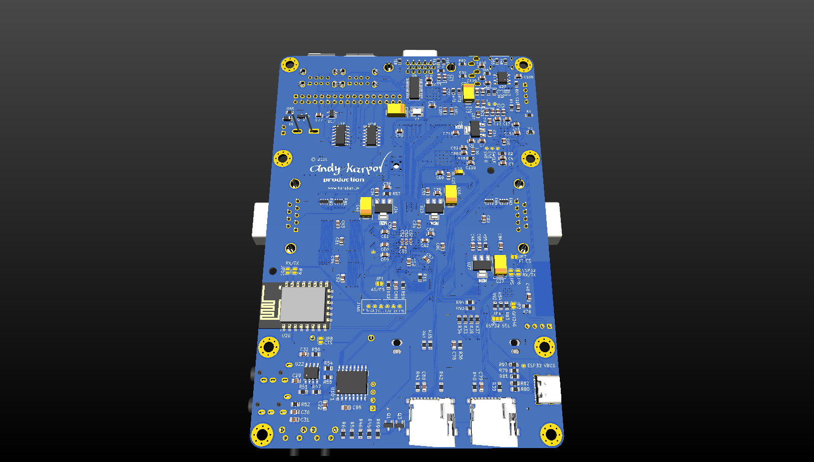
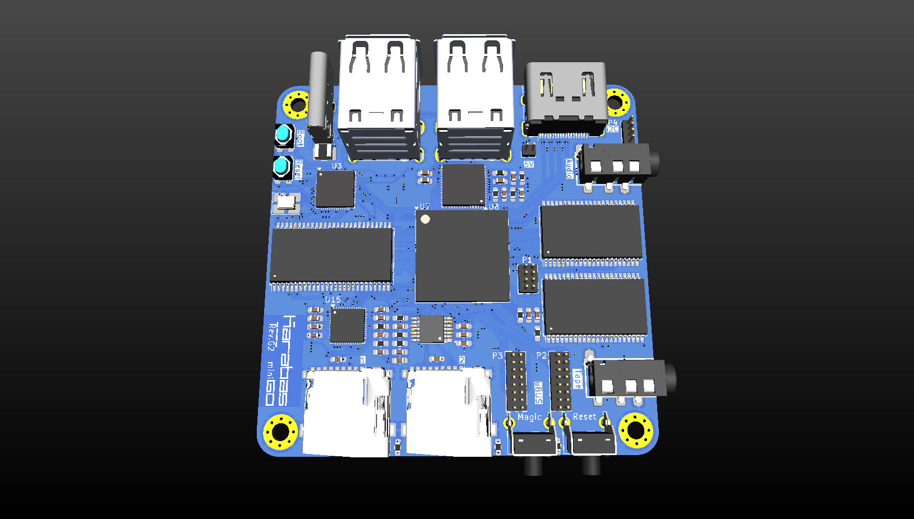
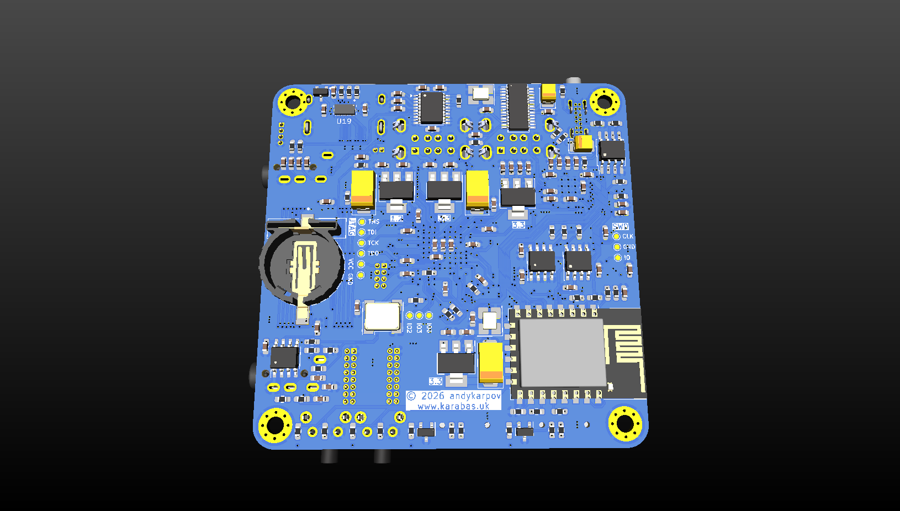
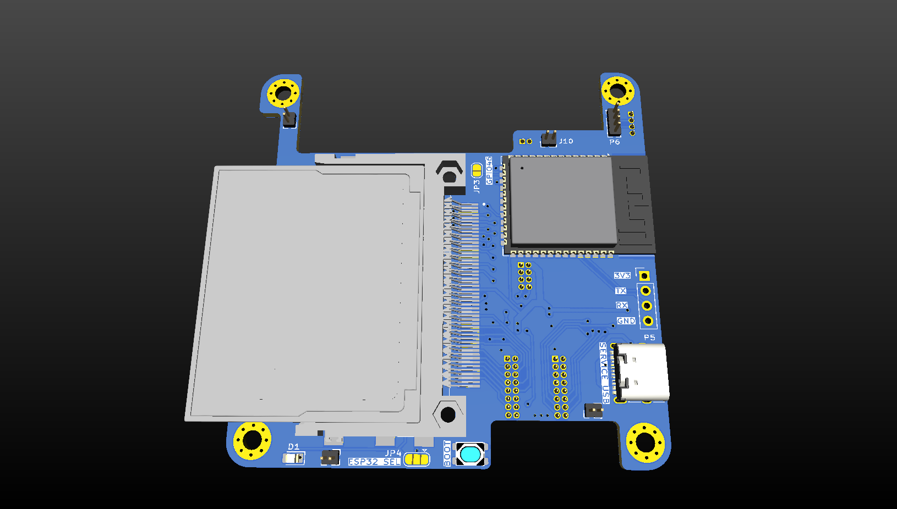
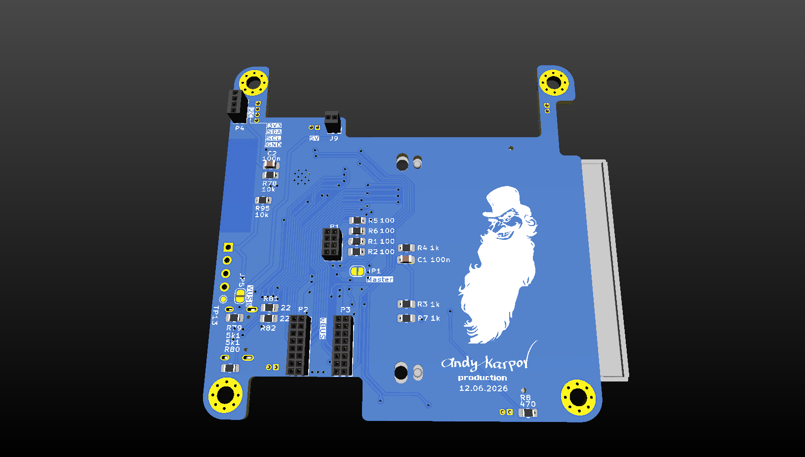
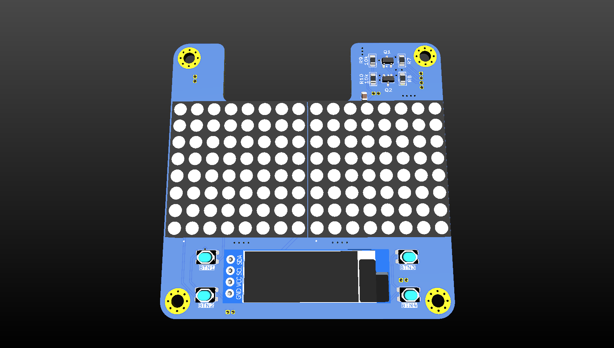
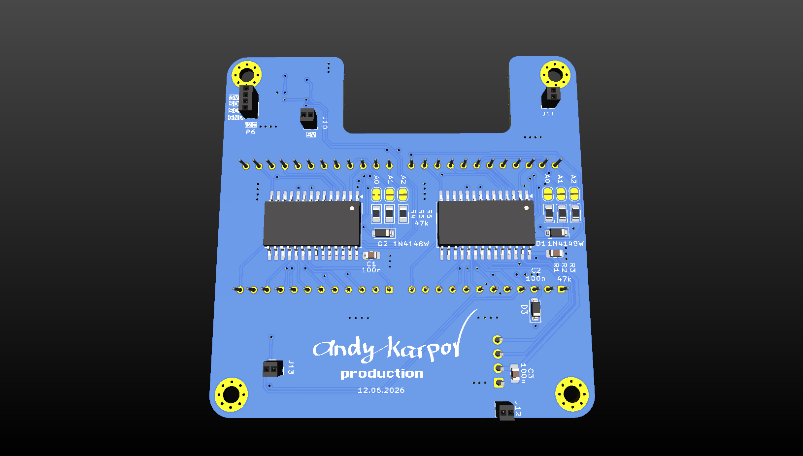

# Karabas Go, Mini, Mini G

[English](README.md) | Русский

Платы на ПЛИС Spartan-6 для эмуляции разных ретрокомпьютеров: Karabas Go и Karabas Mini /
Mini G. В этом репозитории лежит всё, что записывается на SD-карту и в платы (ядра, прошивка),
аппаратная документация (схемы, BOM, гербер-файлы) и 3D-модели корпусов всех плат. (У Mini раньше
был свой репозиторий, [karabas-mini](https://github.com/andykarpov/karabas-mini), теперь он в архиве.)

Схемотехника и документация распространяются по лицензии [Creative Commons Attribution-NonCommercial-ShareAlike 4.0 International](http://creativecommons.org/licenses/by-nc-sa/4.0/).

Ядра ПЛИС, прошивка и прочие программные части распространяются по своим собственным лицензиям.

## С чего начать

[docs/howto.md](docs/howto.md) (на английском): ядра из `cores/` копируются в корень SD-карты 1
(один файл `.kg` на ядро для всех плат), прошивка платы берётся из `firmware/`:

| Плата | Прошивка |
| --- | --- |
| Karabas Go | `firmware/karabas_go.uf2` |
| Karabas Mini, rev.C .. rev.F3 | `firmware/karabas_mini.uf2` |
| Karabas Mini G, rev.G / G2 | `firmware/karabas_minig.uf2` |

Ядрам `.kg` нужна прошивка 26110415 или новее; старая прошивка останавливается с сообщением
"Boot file not found".

[Karabas Flasher](https://github.com/xdemax/kgff) (kgff, автор xdemax, MIT; Windows, Linux, macOS)
делает всё это в одном окне: скачивает прошивку и ядра из этого репозитория, прошивает RP2040,
заменяет ядра `.kg` на SD-карте 1 (старые переносятся в резервную папку), копирует дополнительный
контент (ROM-ы, образы дисков) и определяет модель платы командой `AT+KARABAS=version`.
Для обновления ядер нужна прошивка от 18.10.2026 или новее: если не уверены, сначала обновите
только прошивку.

## Содержимое

| Путь | Что там |
| --- | --- |
| `cores/` | ядра, `*.kg` (один файл для всех плат) |
| `firmware/` | прошивка RP2040 для каждой платы; `esp32-s3/` — прошивка ESP32-S3 шилда Mini G |
| `software/` | дополнительные файлы для ядер (`TBBLUE.FW` для ZX Next, плагины) |
| `docs/go/`, `docs/mini/` | схемы (PDF), интерактивные BOM, рендеры; `docs/mini/revF_mod.md` — доработка тактирования FT812 на Mini rev.C, D, F |
| `pcb/go/`, `pcb/mini/` | гербер-файлы каждой ревизии, `PCB_CHANGELOG.md` |
| `case/go/`, `case/mini/` | 3D-модели корпусов |

## Платы

### Karabas Go

- ПЛИС Spartan-6 на 25k LE
- Микроконтроллер RP2040
- 4 порта USB
- 2 микросхемы SRAM по 2 МБ, 10 нс
- SDRAM 32 МБ
- Выход VGA 8:8:8
- Видеопроцессор FT812 на плате
- 16-битный аудио-ЦАП
- MIDI-синтезатор SAM2695
- 2 порта джойстика DB9, совместимых с Sega / Atari
- CF-карта
- 2 карты microSD
- Магнитофонный вход / выход
- Порт дисковода (FDD)
- Пищалка
- Часы реального времени DS3221
- EEPROM 1 КБ
- Модуль Wi-Fi ESP8266

Последняя ревизия платы — Rev.B4 ([список изменений](pcb/go/PCB_CHANGELOG.md)). Rev.B4 может
не совсем подходить к 3D-моделям корпусов: её карты microSD немного сдвинуты вперёд.
Исходники платы: [karabas-go-pcb](https://github.com/andykarpov/karabas-go-pcb).

### Karabas Mini / Mini G

- ПЛИС Spartan-6 на 25k LE
- Микроконтроллер RP2040
- 4 порта USB
- 2 микросхемы SRAM по 2 МБ, 10 нс
- SDRAM 32 МБ
- Выход DVI
- Видеопроцессор FT812 на плате
- MIDI-синтезатор SAM2695
- 2 карты microSD
- Магнитофонный вход / выход
- Часы реального времени DS3221
- EEPROM 1 КБ
- Модуль Wi-Fi ESP8266
- Разъём расширения uBUS
- ESP32-S3 как микроконтроллер VDAC32
- CF-карта

Последняя стабильная ревизия платы — Rev.G ([список изменений](pcb/mini/PCB_CHANGELOG.md)).
Ревизиям C, D и F для ядер, использующих FT812, нужна небольшая [доработка](docs/mini/revF_mod.md).
Исходники платы: [karabas-mini-pcb](https://github.com/andykarpov/karabas-mini-pcb).

Шилд с CF-картой и ESP32-S3 для rev.G (второй этаж):

Шилд для шилда v4 с матричным дисплеем (третий этаж):

## Исходники

Ядра ПЛИС:

- Загрузочное меню: https://github.com/andykarpov/karabas-go-core-menu
- Тестовое ядро: https://github.com/andykarpov/karabas-go-core-test
- TS-Conf: https://github.com/andykarpov/karabas-go-core-tsconf
- ZX Spectrum Next: https://github.com/andykarpov/karabas-go-core-next
- Karabas Pro: https://github.com/andykarpov/karabas-go-core-profi
- PCXT: https://github.com/andykarpov/karabas-go-core-pcxt
- NES: https://github.com/andykarpov/karabas-go-core-nes
- SNES: https://github.com/andykarpov/karabas-go-core-snes
- Семейство Радио-86РК (РК86, Микроша, Апогей, Партнёр, Микро-80): https://github.com/andykarpov/karabas-go-core-rk
- Alf: https://github.com/andykarpov/karabas-go-core-alf
- MSX1: https://github.com/andykarpov/karabas-go-core-msx
- MSX2 / MSX2+: https://github.com/andykarpov/karabas-go-core-msx2
- ZX Evolution BaseConf: https://github.com/andykarpov/karabas-go-core-baseconf
- УКНЦ (МС-0511): https://github.com/andykarpov/karabas-go-core-uknc
- Орион-128: https://github.com/andykarpov/karabas-go-core-orion128
- Орион-ПРО: https://github.com/andykarpov/karabas-go-core-orionpro
- Специалист / Специалист-MX: https://github.com/andykarpov/karabas-go-core-specialist
- БК-0011М + AZBK: https://github.com/andykarpov/karabas-go-core-bk
- Atari ST / STE: https://github.com/andykarpov/karabas-go-core-atarist
- Sinclair QL: https://github.com/andykarpov/karabas-go-core-ql
- PDP-11/70: https://github.com/tsybulin/karabas-go-core-pdp2026
- Commodore VIC-20: https://github.com/andykarpov/karabas-go-core-vic20
- Commodore 64: https://github.com/xdemax/karabas-go-core-c64
- Apple Macintosh Plus: https://github.com/andykarpov/karabas-go-core-macplus
- Apple //e: https://github.com/andykarpov/karabas-go-core-apple2
- Atari 2600 VCS: https://github.com/andykarpov/karabas-go-core-atari2600
- V6Z80P+ (OSCA): https://github.com/Caasper911/karabas-go-core-v6z80p

Прошивка: https://github.com/andykarpov/karabas-go-firmware

Инструменты разработки (`make_core`): https://github.com/andykarpov/karabas-go-tools
