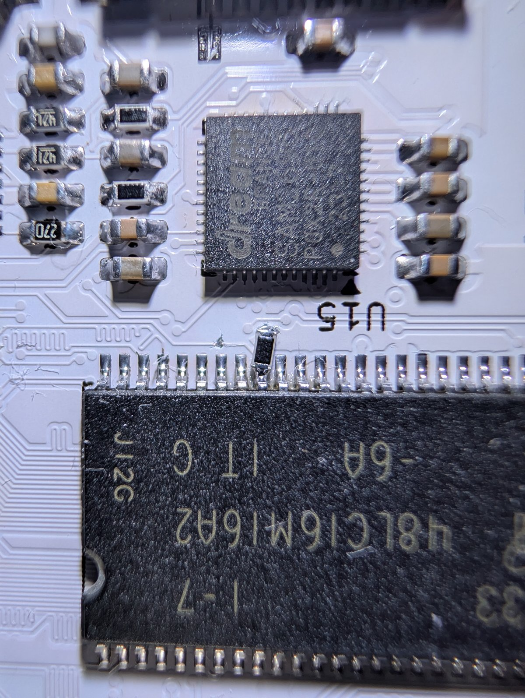

### Required HW mod for Rev.G2: SDRAM ~CS

On Rev.G2 the SDRAM U11 pin 19 (~CS) is wired to the FPGA pin T3 (net ~SDR_CS). On the earlier revisions
T3 is the config flash chip select, so the cores drive it high: on a G2 board the SDRAM is never selected
and every core that uses it fails (only `sdram-test` works). Errata:
[Errata-revG2.txt](https://github.com/andykarpov/karabas-mini-pcb/blob/master/Errata-revG2.txt).

To perform the mod:

1. Cut the ~SDR_CS track next to U11 pin 19 (top layer only, no vias).
2. Connect U11 pin 19 to GND through a 1k (1k..10k) resistor.

A pull-down without the cut does not work: the FPGA output keeps the pin high.

Photo: [karabas-mini-pcb#2](https://github.com/andykarpov/karabas-mini-pcb/issues/2), the mod checked on a G2 board.

---

### Обязательная доработка Rev.G2: ~CS SDRAM

На Rev.G2 вывод 19 (~CS) SDRAM U11 подключён к выводу T3 FPGA (цепь ~SDR_CS). На прежних ревизиях T3 —
выбор конфигурационной флешки, и ядра держат его в 1: на плате G2 SDRAM никогда не выбирается, и все ядра,
использующие её, не работают (работает только `sdram-test`).

1. Перерезать дорожку ~SDR_CS у вывода 19 U11 (только верхний слой, без переходных).
2. Соединить вывод 19 U11 с GND через резистор 1k (1k..10k).

Подтяжка без разреза не помогает: выход FPGA держит вывод в 1.
